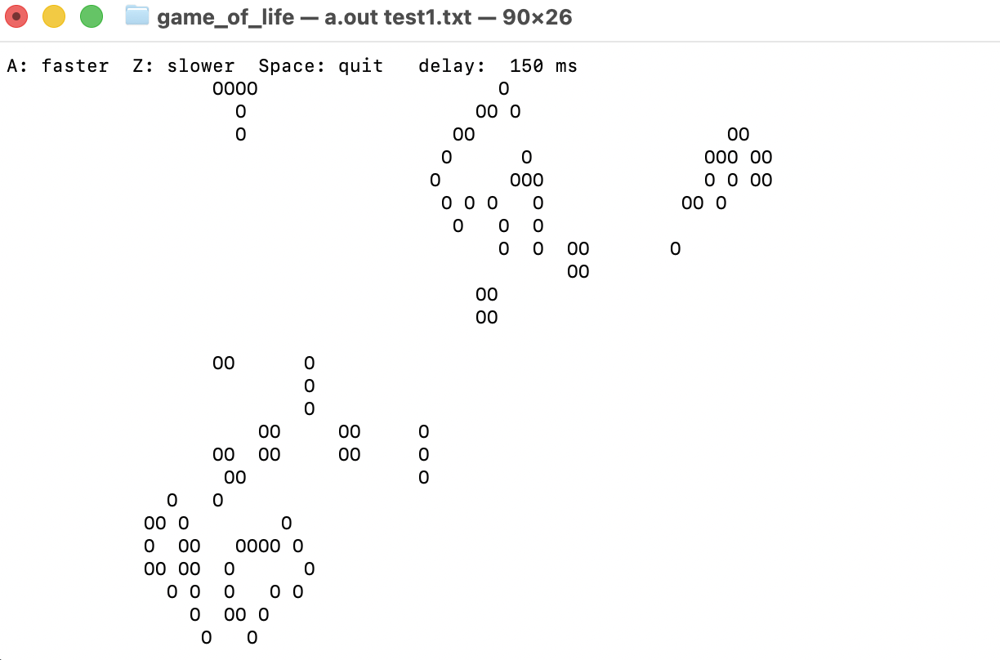
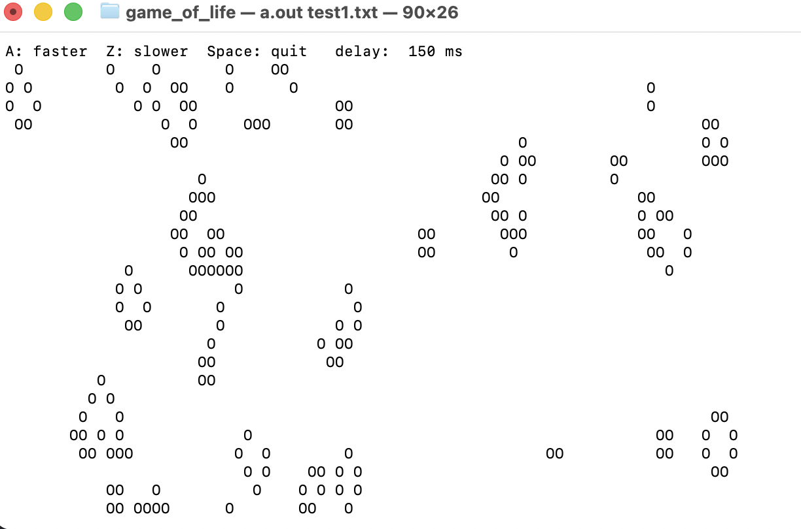

# Game of Life

A terminal implementation of **Conway's Game of Life** cellular automaton in C.
This project was completed as a group assignment at **School 21** by a team of two.
Both team members already had programming experience, so the focus was not only on a
working simulation, but also on program structure, interactive controls, and careful
terminal handling.

## What it looks like





## Project idea

Game of Life simulates cells living on a two-dimensional grid. Each cell can be alive
or dead, and the next generation is calculated using a few simple rules:

- a live cell survives if it has 2 or 3 live neighbors;
- a live cell dies of underpopulation or overpopulation in all other cases;
- a dead cell becomes alive if it has exactly 3 live neighbors.

Despite their simplicity, these rules produce stable structures, moving patterns, and
complex behavior.

## Features

- fixed-size `80x25` grid;
- terminal rendering with `ncurses`;
- interactive control of the simulation speed;
- exit with the `Space` key;
- wraparound grid edges: cells at an edge interact with cells on the opposite side;
- load an initial state from a file or standard input;
- 5 ready-made test patterns: `test1.txt` through `test5.txt`.

## Libraries used

- `ncurses.h` - terminal screen control, grid rendering, and non-blocking key input;
- `stdio.h` - file and standard input/output operations, and error messages;
- `unistd.h` - POSIX functions for working with terminal file descriptors.

The project does not use `system()` and does not require dynamic memory allocation.

## Implementation details

### Toroidal grid

The grid wraps around at its edges: when a cell is on an edge, its neighbors are
counted from the opposite side of the grid. This is implemented with the modulo
operator:

```c
int new_y = (y + delta_y + HEIGHT) % HEIGHT;
int new_x = (x + delta_x + WIDTH) % WIDTH;
```

This avoids separate conditions for corners and edges.

### Double buffering

Two arrays are used to calculate the next generation:

- `cur` - the current state of the grid;
- `next` - the new state of the grid.

This matters because all cells in a generation must update simultaneously. If `cur`
were changed while iterating over it, the new values would start affecting neighboring
cells in the same step, and the Game of Life rules would no longer work correctly.

### Non-blocking controls

`ncurses` is configured with `nodelay(stdscr, TRUE)`, so the program does not stop the
simulation while waiting for a key press. On each frame, it checks whether a key was
pressed, applies the action, and continues the calculation.

### Loading from a file or stdin

The program supports two ways to load a pattern:

```bash
./a.out test2.txt
```

and

```bash
./a.out < test2.txt
```

After reading the input, the program reconnects to `/dev/tty` so that `ncurses` can
read keys from the terminal even when the initial grid was provided through redirected
`stdin`.

## Requirements

- a C compiler, such as `gcc`;
- the `ncurses` library;
- a terminal at least `80x26` characters in size.

On macOS, `ncurses` is usually available already. On Linux, install it with your package
manager if needed, for example with `libncurses-dev` or `ncurses-devel`.

## Build

From the project root, run:

```bash
gcc game_of_life.c -lncurses
```

This creates an executable named `a.out`.

For a stricter build with warnings enabled, run:

```bash
gcc -Wall -Wextra -Werror game_of_life.c -lncurses
```

## Run

Run with a ready-made pattern:

```bash
./a.out test1.txt
```

Other options:

```bash
./a.out test2.txt
./a.out test3.txt
./a.out test4.txt
./a.out test5.txt
```

You can also pass the grid through standard input:

```bash
./a.out < test1.txt
```

## Controls

- `A` - speed up the simulation;
- `Z` - slow down the simulation;
- `Space` - exit the program.

The current delay between generations is shown on the terminal's top line.

## Input file format

The initial state file contains 25 lines. Each line describes one row of the grid.

- `O` - a live cell;
- any other character, such as `.`, is treated as an empty cell.

Example fragment:

```text
................................................................................
.O..............................................................................
..OO............................................................................
.OO.............................................................................
................................................................................
```

The project grid is 80 characters wide and 25 lines tall. If a line is shorter, the
remaining cells are treated as empty.

## Program behavior

After launch, the program reads the initial grid, switches the terminal to full-screen
mode, and starts updating generations. Live cells are displayed as `O` and empty cells
as spaces. At each step, the program:

1. clears the screen;
2. draws the status line and the grid;
3. checks for key presses;
4. calculates the next generation;
5. pauses for the current delay.

If the program exits immediately, check the terminal window size: it must be at least
`80x26`, because the grid uses 25 lines and the status line needs one more.

## Project structure

```text
.
├── game_of_life.c
├── README.md
├── README_RUS.md
├── test1.txt
├── test2.txt
├── test3.txt
├── test4.txt
├── test5.txt
└── img/
    ├── game-of-life-start.png
    └── game-of-life-running.png
```

## Team

This project was completed by a team of two as part of School 21.

Team roles:

- Team Lead;
- Developer.

Both team members had programming experience, so the work was organized around
designing the logic, implementing the terminal interface, preparing patterns, and
checking the simulation's behavior.
